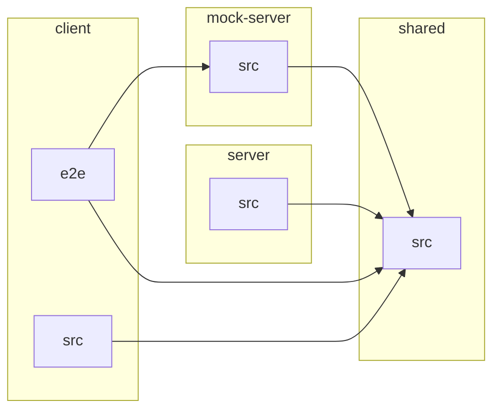
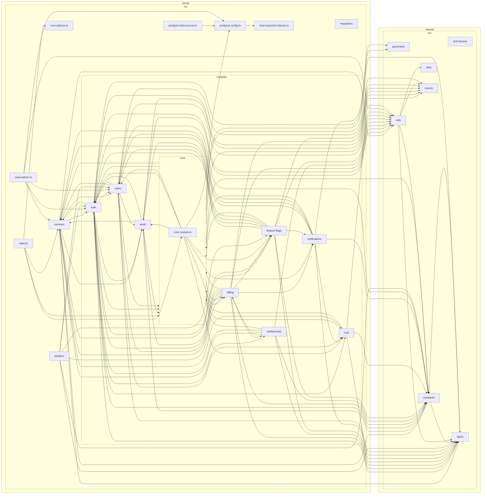
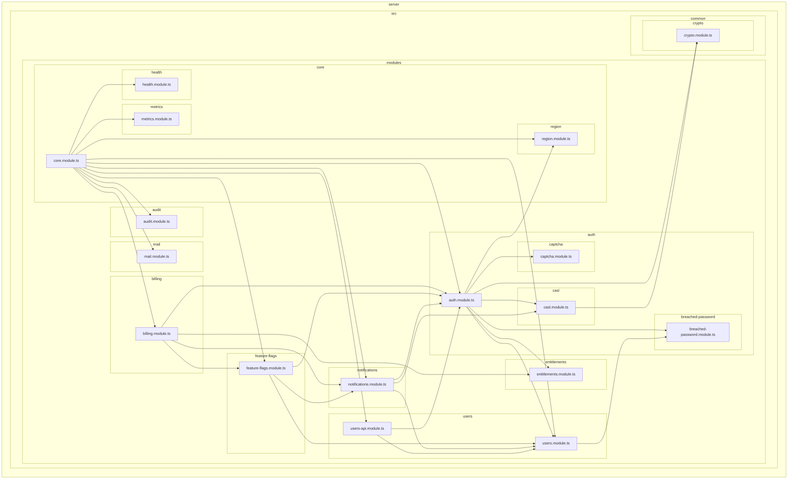
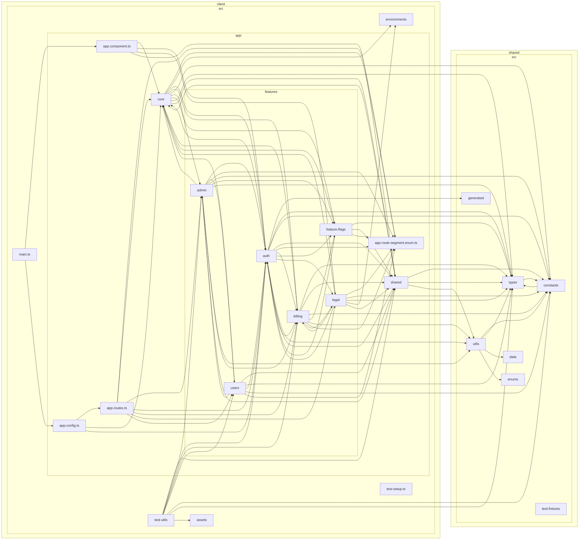
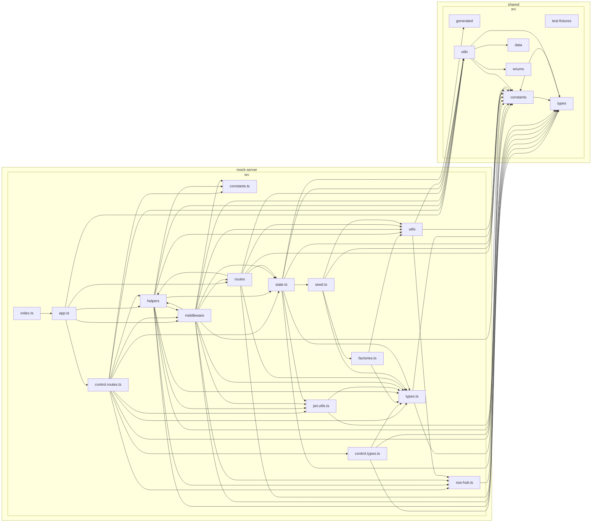

# Dependency graph

Generated by `npm run graph` (from `server/`) from the imports of the files that git tracks. Do not edit this file. CI runs `npm run graph:check` and fails when the file is out of date.

Spec files are not in the graph. An HTTP call from the client to the server is not an import, so it is not in the graph: `contracts/routes.json` lists the routes.

For an interactive file-level view, run `npm run graph -- --html` (needs Graphviz) and open the pages in `architecture/html/`.

## Workspaces

Each node is one source root. An arrow is at least one import.

## Server modules

Each folder of `server/src/modules` is one node, so an arrow is any import between two folders: an entity relation, a decorator, a service. `core.module.ts` is the composition root and has its own node. The other files of `core/` are shared infrastructure. The Nest module graph is the next view.

## Server Nest modules

Each `*.module.ts` file is one node, and an arrow is an import between two module files. Two folders can import each other while their Nest modules do not: for example `AuthModule` imports `UsersModule`, and `UsersApiModule` imports `AuthModule`.

## Client modules

Each feature folder is one node.

## Mock server modules

Each top-level folder or file of `mock-server/src` is one node.

