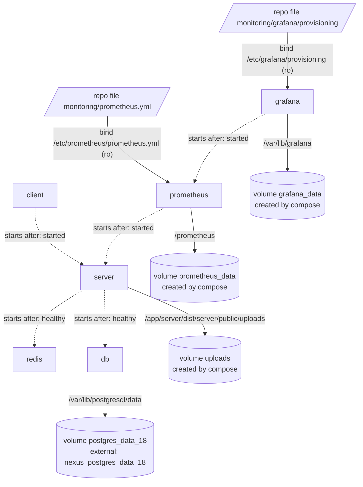
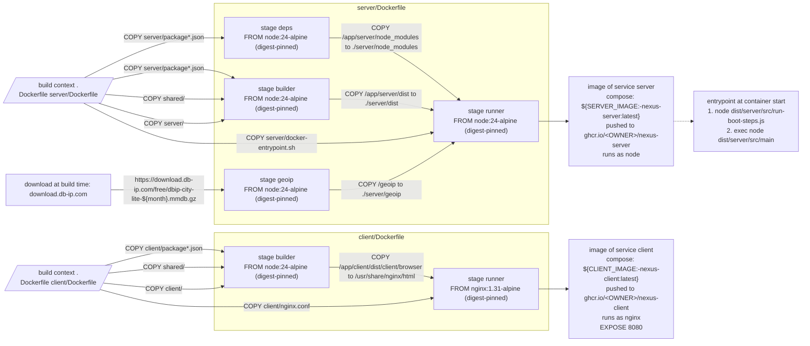
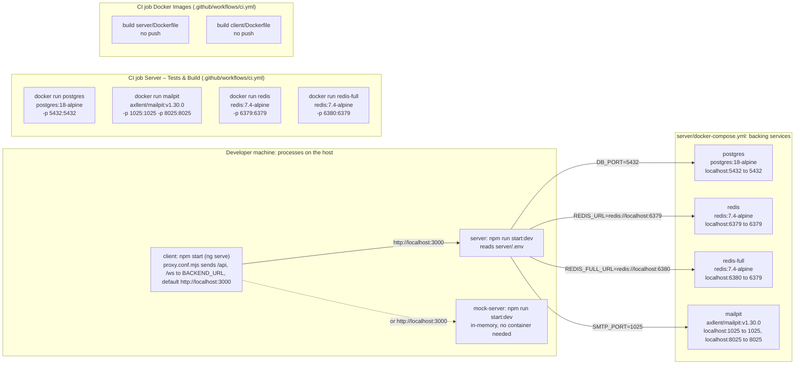

# Docker graph

Generated by `npm run graph` (from `server/`) from the compose files, the Dockerfiles, the configs that name another container, the workflows and the egress lists of `shared/`. Do not edit this file. CI runs `npm run graph:check` and fails when the file is out of date.

The production names are those of the `intl` cell (`CELL` unset). A value in `${...}` that does not depend on `CELL` comes from an env file on the host, which is not in the repository (`.env.example` and `cells/.env.example` are the templates).

## Production: connections at run time

Source: `docker-compose.yml`. A solid arrow is a connection that a config file names: an environment value of the service, the nginx config of its image, or a Prometheus or Grafana file that it mounts. Each service is also on the network `default` of the project.

```mermaid
flowchart LR
  browser(["Browser"])
  net_proxy["Reverse proxy of the host (not in this repository)<br/>TLS; joins the external network shared-network"]
  browser -->|"HTTPS"| net_proxy
  subgraph project["Compose project nexus, network default"]
    svc_redis["redis<br/>redis:7.4-alpine"]
    svc_db["db<br/>postgres:18-alpine"]
    svc_server["server<br/>${SERVER_IMAGE:-nexus-server:latest}<br/>listens 3000"]
    svc_client["client<br/>${CLIENT_IMAGE:-nexus-client:latest}<br/>listens 8080"]
    svc_prometheus["prometheus<br/>prom/prometheus:v3.12.0<br/>listens 9090"]
    svc_grafana["grafana<br/>grafana/grafana:13.0.1<br/>listens 3000"]
  end
  net_proxy <-->|"network proxy, alias nexus-intl-server"| svc_server
  net_proxy <-->|"network proxy, alias nexus-intl-client"| svc_client
  host_127_0_0_1["Host 127.0.0.1"]
  host_127_0_0_1 -->|"${CLIENT_HOST_PORT:-4200} to 8080"| svc_client
  net_proxy <-->|"network proxy, no alias"| svc_grafana
  host_127_0_0_1["Host 127.0.0.1"]
  host_127_0_0_1 -->|"${GRAFANA_HOST_PORT:-3001} to 3000"| svc_grafana
  svc_server -->|"DB_HOST=db"| svc_db
  svc_server -->|"REDIS_URL=redis://redis:6379"| svc_redis
  svc_client -->|"nginx upstream backend: /api/"| svc_server
  svc_client -->|"nginx upstream backend: /ws/"| svc_server
  svc_prometheus -->|"scrape nestjs-server: server:3000/metrics"| svc_server
  svc_grafana -->|"datasource Prometheus: http://prometheus:9090"| svc_prometheus
  recv_ops_webhook["Alert receiver ops-webhook (webhook)<br/>$ALERT_WEBHOOK_URL"]
  svc_grafana -->|"alert notification"| recv_ops_webhook
  subgraph egress["External services that the server calls"]
    ext_paddle["paddle<br/>regions: intl"]
    ext_yookassa["yookassa<br/>regions: ru"]
    ext_turnstile["turnstile<br/>regions: intl"]
    ext_googleOAuth["googleOAuth<br/>regions: intl"]
    ext_facebookOAuth["facebookOAuth<br/>regions: intl"]
    ext_vkOAuth["vkOAuth<br/>regions: intl, ru"]
    ext_smtp["SMTP provider (SMTP_HOST)<br/>intl cell accepts: intl, ru<br/>ru cell accepts: ru"]
    ext_DEFAULT_PWNED_RANGE_URL["api.pwnedpasswords.com<br/>DEFAULT_PWNED_RANGE_URL"]
  end
  svc_server -->|"HTTPS, SMTP"| egress
  webhooks["Billing providers: webhook calls<br/>source IPs checked by BILLING_WEBHOOK_IP_ALLOWLIST"]
  webhooks -->|"to server"| net_proxy
  subgraph browserext["Third parties that the CSP lets the browser load"]
    csp_buy_paddle_com["buy.paddle.com<br/>frame-src"]
    csp_cdn_paddle_com["cdn.paddle.com<br/>script-src, style-src, img-src"]
    csp_challenges_cloudflare_com["challenges.cloudflare.com<br/>script-src, frame-src"]
    csp_sandbox_buy_paddle_com["sandbox-buy.paddle.com<br/>frame-src"]
    csp_sandbox_cdn_paddle_com["sandbox-cdn.paddle.com<br/>style-src, img-src"]
  end
  browser -.-> browserext
```



## Production: start order and storage

Source: `docker-compose.yml`. A dotted arrow is `depends_on`: the service starts after the other one is started or healthy.



## Production: services

| Service | Image | Build | Host ports | Networks | Healthcheck | Memory | Capabilities | Restart |
|---|---|---|---|---|---|---|---|---|
| `redis` | `redis:7.4-alpine` |  |  | default | redis-cli ping | 96m | drop ALL; add SETUID SETGID; no-new-privileges:true | unless-stopped |
| `db` | `postgres:18-alpine` |  |  | default | pg_isready -U ${DB_USER} -d ${DB_NAME} | 256m, reserve 96m | drop ALL; add CHOWN DAC_OVERRIDE FOWNER SETGID SETUID; no-new-privileges:true | unless-stopped |
| `server` | `${SERVER_IMAGE:-nexus-server:latest}` | `server/Dockerfile` |  | default, proxy | GET /api/health/ready | 384m, reserve 128m | drop ALL; no-new-privileges:true | unless-stopped |
| `client` | `${CLIENT_IMAGE:-nexus-client:latest}` | `client/Dockerfile` | 127.0.0.1:${CLIENT_HOST_PORT:-4200} to 8080 | default, proxy | GET / | 64m | drop ALL; no-new-privileges:true | unless-stopped |
| `prometheus` | `prom/prometheus:v3.12.0` |  |  | default | GET /-/healthy | 192m | drop ALL; no-new-privileges:true | unless-stopped |
| `grafana` | `grafana/grafana:13.0.1` |  | 127.0.0.1:${GRAFANA_HOST_PORT:-3001} to 3000 | default, proxy | GET /api/health | 384m, reserve 192m | drop ALL; no-new-privileges:true | unless-stopped |

## Production: names of each cell

The names that `CELL` changes. `scripts/cell.sh` runs a cell other than `intl` with its own env file.

| Name | intl (CELL unset) | ru (CELL=ru) |
|---|---|---|
| Compose project | `nexus` | `nexus-ru` |
| Volume `postgres_data_18` | `nexus_postgres_data_18` | `nexus-ru_postgres_data_18` |
| Network `proxy` | `shared-network` | `nexus-ru-proxy` |
| Alias of `server` on `proxy` | `nexus-intl-server` | `nexus-ru-server` |
| Env file of `server` | `server/.env` | `cells/ru/server/.env` |
| `DATA_REGION` of `server` | `intl` | `ru` |
| Alias of `client` on `proxy` | `nexus-intl-client` | `nexus-ru-client` |

## Image build

Each image is built from the repository root as the build context. The Deploy workflow builds, scans and pushes it (next section).



### Instructions

| Dockerfile | Stage | Instruction | Arguments |
|---|---|---|---|
| `server/Dockerfile` | deps | RUN | `apk upgrade --no-cache && apk add --no-cache python3 make g++` |
| `server/Dockerfile` | deps | WORKDIR | `/app` |
| `server/Dockerfile` | deps | COPY | `server/package*.json ./server/` |
| `server/Dockerfile` | deps | RUN | `cd server && npm ci --omit=dev` |
| `server/Dockerfile` | builder | RUN | `apk upgrade --no-cache && apk add --no-cache python3 make g++` |
| `server/Dockerfile` | builder | WORKDIR | `/app` |
| `server/Dockerfile` | builder | COPY | `server/package*.json ./server/` |
| `server/Dockerfile` | builder | RUN | `cd server && npm ci` |
| `server/Dockerfile` | builder | COPY | `shared/ ./shared/` |
| `server/Dockerfile` | builder | COPY | `server/ ./server/` |
| `server/Dockerfile` | builder | RUN | `cd server && npm run build` |
| `server/Dockerfile` | geoip | WORKDIR | `/geoip` |
| `server/Dockerfile` | geoip | RUN | `set -o pipefail; this_month=$(date -u +%Y-%m); last_month=$(date -u -d "@$(( $(date -u -d "${this_month}-01" +%s) - 86400 ))" +%Y-%m); for month in "$this_month" "$last_month"; do if wget -qO- "https://download.db-ip.com/free/dbip-city-lite-${month}.mmdb.gz" \| gunzip > dbip-city-lite.mmdb; then echo "GeoIP database: dbip-city-lite-${month}"; exit 0; fi; done; rm -f dbip-city-lite.mmdb; echo "WARNING: GeoIP database not downloaded; session locations are disabled"` |
| `server/Dockerfile` | runner | RUN | `apk upgrade --no-cache && rm -rf /usr/local/lib/node_modules/npm /usr/local/bin/npm /usr/local/bin/npx` |
| `server/Dockerfile` | runner | WORKDIR | `/app` |
| `server/Dockerfile` | runner | COPY | `--from=deps /app/server/node_modules ./server/node_modules` |
| `server/Dockerfile` | runner | COPY | `--from=builder /app/server/dist ./server/dist` |
| `server/Dockerfile` | runner | COPY | `--from=geoip /geoip ./server/geoip` |
| `server/Dockerfile` | runner | ENV | `GEOIP_DB_PATH=/app/server/geoip/dbip-city-lite.mmdb` |
| `server/Dockerfile` | runner | RUN | `mkdir -p server/dist/server/public/uploads` |
| `server/Dockerfile` | runner | COPY | `server/docker-entrypoint.sh ./server/docker-entrypoint.sh` |
| `server/Dockerfile` | runner | RUN | `chmod +x server/docker-entrypoint.sh` |
| `server/Dockerfile` | runner | RUN | `chown -R node:node /app/server` |
| `server/Dockerfile` | runner | USER | `node` |
| `server/Dockerfile` | runner | WORKDIR | `/app/server` |
| `server/Dockerfile` | runner | ENTRYPOINT | `["./docker-entrypoint.sh"]` |
| `client/Dockerfile` | builder | WORKDIR | `/app` |
| `client/Dockerfile` | builder | COPY | `client/package*.json ./client/` |
| `client/Dockerfile` | builder | RUN | `cd client && npm ci --ignore-scripts` |
| `client/Dockerfile` | builder | COPY | `shared/ ./shared/` |
| `client/Dockerfile` | builder | COPY | `client/ ./client/` |
| `client/Dockerfile` | builder | ARG | `COMMIT_HASH=unknown` |
| `client/Dockerfile` | builder | ARG | `BASE_HREF=/nexus/` |
| `client/Dockerfile` | builder | RUN | `cd client && COMMIT_HASH=$COMMIT_HASH NODE_OPTIONS="--max-old-space-size=2048" npm run build -- --base-href $BASE_HREF` |
| `client/Dockerfile` | runner | RUN | `apk upgrade --no-cache && mkdir -p /var/cache/nginx /tmp/nginx && chown -R nginx:nginx /var/cache/nginx /tmp/nginx /usr/share/nginx/html && sed -i 's\|/run/nginx.pid\|/tmp/nginx/nginx.pid\|' /etc/nginx/nginx.conf` |
| `client/Dockerfile` | runner | RUN | `apk add --no-cache --upgrade brotli-libs` |
| `client/Dockerfile` | runner | COPY | `--from=builder /app/client/dist/client/browser /usr/share/nginx/html` |
| `client/Dockerfile` | runner | COPY | `client/nginx.conf /etc/nginx/conf.d/default.conf` |
| `client/Dockerfile` | runner | USER | `nginx` |
| `client/Dockerfile` | runner | EXPOSE | `8080` |

### Build context filters

| File | Read by a build | Patterns |
|---|---|---|
| `.dockerignore` | yes | `.git` `.gitignore` `.github` `doc/` `mock-server/` `.env` `server/.env` `server/.env.local` `client/.env` `server/node_modules` `client/node_modules` `server/dist` `client/dist` `server/coverage` `client/playwright-report` `client/test-results` `*.log` `.editorconfig` |
| `client/.dockerignore` | no: no build has this context or this Dockerfile | `node_modules` `dist` `.cache` |
| `server/.dockerignore` | no: no build has this context or this Dockerfile | `node_modules` `dist` `.env` `.env.local` `coverage` |

## Delivery

Source: `.github/workflows/deploy.yml`.

```mermaid
flowchart LR
  trig_workflow_run(["workflow_run: CI completed on master"])
  trig_workflow_dispatch(["workflow_dispatch"])
  subgraph job_build_push["job Build & Push Images"]
    direction TB
    build_push_0["actions/checkout@v6"]
    build_push_1["Get commit short SHA"]
    build_push_0 --> build_push_1
    build_push_2["docker/setup-buildx-action@v4"]
    build_push_1 --> build_push_2
    build_push_3["docker/login-action@v4"]
    build_push_2 --> build_push_3
    build_push_4["Lowercase repository owner"]
    build_push_3 --> build_push_4
    build_push_5["Server image metadata<br/>docker/metadata-action@v6"]
    build_push_4 --> build_push_5
    build_push_6["Client image metadata<br/>docker/metadata-action@v6"]
    build_push_5 --> build_push_6
    build_push_7["Build server image<br/>docker/build-push-action@v7"]
    build_push_6 --> build_push_7
    build_push_8["Scan server image<br/>aquasecurity/trivy-action@v0.36.0"]
    build_push_7 --> build_push_8
    build_push_9["Build client image<br/>docker/build-push-action@v7"]
    build_push_8 --> build_push_9
    build_push_10["Scan client image<br/>aquasecurity/trivy-action@v0.36.0"]
    build_push_9 --> build_push_10
    build_push_11["Push server image"]
    build_push_10 --> build_push_11
    build_push_12["Push client image"]
    build_push_11 --> build_push_12
  end
  trig_workflow_run --> job_build_push
  trig_workflow_dispatch --> job_build_push
  reg_ghcr_io__OWNER__nexus_server[("registry ghcr.io/#lt;OWNER#gt;/nexus-server")]
  build_push_11 -->|"tag sha-#lt;COMMIT_HASH#gt;"| reg_ghcr_io__OWNER__nexus_server
  build_push_11 -->|"tag latest"| reg_ghcr_io__OWNER__nexus_server
  reg_ghcr_io__OWNER__nexus_client[("registry ghcr.io/#lt;OWNER#gt;/nexus-client")]
  build_push_12 -->|"tag sha-#lt;COMMIT_HASH#gt;"| reg_ghcr_io__OWNER__nexus_client
  build_push_12 -->|"tag latest"| reg_ghcr_io__OWNER__nexus_client
  subgraph job_deploy["job Deploy to VPS"]
    direction TB
    deploy_0["actions/checkout@v6"]
    deploy_1["Preseed the SSH client<br/>./.github/actions/preseed-ssh-client"]
    deploy_0 --> deploy_1
    deploy_2["Deploy via SSH<br/>appleboy/ssh-action@v1"]
    deploy_1 --> deploy_2
  end
  job_build_push -->|"needs"| job_deploy
  hostcompose["docker compose on the host<br/>docker-compose.yml at the deployed commit"]
  deploy_2 -->|"SSH script"| hostcompose
```



### Deploy to VPS: Deploy via SSH

The conditions and the commands that change state, in the order of the script:

```text
git checkout HEAD -- docker-compose.yml 2>/dev/null || true
git_authed_retry pull --ff-only
git checkout "${DEPLOY_SHA}" -- docker-compose.yml
if [ -f .deployed-sha ]; then
if [ -z "${GRAFANA_ADMIN_PASSWORD:-}" ]; then
  exit 1
if [ -z "${ALERT_WEBHOOK_URL:-}" ]; then
  exit 1
bash scripts/sync-prod-env.sh
docker compose pull
timeout 300 docker compose up -d --remove-orphans || echo "up -d did not return in 300s - continuing to the health check"
if [ -z "$PREV_SHA" ] || ! git diff --quiet "$PREV_SHA" "$DEPLOY_SHA" -- monitoring/grafana/provisioning; then
  docker compose restart grafana
if [ "$EXPECTED" -lt 1 ]; then EXPECTED=4; fi
while [ $ELAPSED -lt $TIMEOUT ]; do
  if docker compose ps --format '{{.Health}}' | grep -q 'unhealthy'; then
  if [ "$HEALTHY" -ge "$EXPECTED" ]; then
if [ "$HEALTHY" -ge "$EXPECTED" ]; then
  cp -f .deployed-sha .prev-deployed-sha 2>/dev/null || true
  echo "$DEPLOY_SHA" > .deployed-sha
  docker images --format '{{.Repository}}:{{.Tag}}' | grep -E '^ghcr\.io/[^/]+/nexus-(server|client):(sha-|pre-rebuild$)' | xargs -r docker rmi || true
  docker image prune -f
  exit 0
if [ -z "$PREV_SHA" ]; then
  docker compose down
  exit 1
docker pull "ghcr.io/${OWNER}/nexus-server:sha-${PREV_SHA}"
docker pull "ghcr.io/${OWNER}/nexus-client:sha-${PREV_SHA}"
docker tag "ghcr.io/${OWNER}/nexus-server:sha-${PREV_SHA}" "ghcr.io/${OWNER}/nexus-server:latest"
docker tag "ghcr.io/${OWNER}/nexus-client:sha-${PREV_SHA}" "ghcr.io/${OWNER}/nexus-client:latest"
git_authed_retry fetch --quiet origin
git checkout "${PREV_SHA}" -- docker-compose.yml
docker compose down
timeout 300 docker compose up -d || echo "up -d did not return in 300s - continuing to the health check"
while [ $ELAPSED -lt $TIMEOUT ]; do
  if docker compose ps --format '{{.Health}}' | grep -q 'unhealthy'; then
  if [ "$ROLLBACK_HEALTHY" -ge "$EXPECTED" ]; then
if [ "$ROLLBACK_HEALTHY" -ge "$EXPECTED" ]; then
else
exit 1
```

## Development and CI

Sources: `server/docker-compose.yml`, `server/.env.example`, `client/proxy.conf.mjs` and the `docker` steps of `.github/workflows/ci.yml`. An arrow from the server names the setting that points it at the container.


